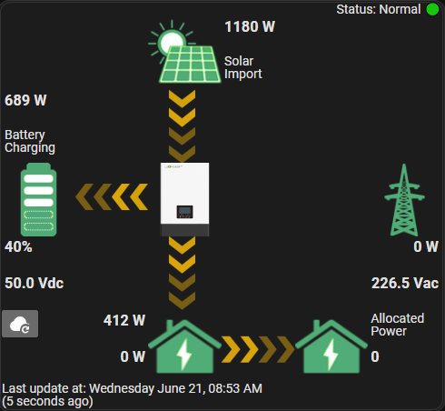
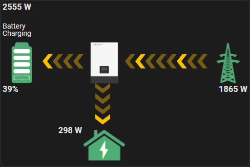
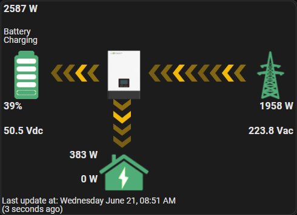
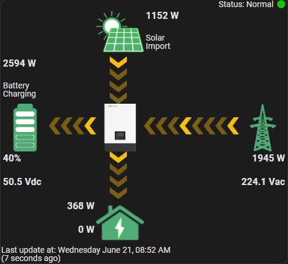

# LuxPower Distribution Card

A simple power distribution card of an inverter and battery system, for [Home Assistant](https://home-assistant.io/). The card is modelled after LuxpowerTek's app and website.

## Installation

### HACS

This card has been added to the list of default HACS frontend elements. Search for the name on HACS, and download from there to install.

## Adding the card to the dashboard

Every option can be set in the UI editor, or in `yaml`. The editor also lists what is still needed to finish the setup, and warns about options the card would ignore (typos, old option names, lists with the wrong number of entries). There are examples in [config](/docs/config/config.md) document.

## LuxpowerTek integration

The LuxpowerTek integration is hosted in a private repository by [Guy Wells](https://github.com/guybw).

## Refresh and the Dongle serial number

By default the refresh button calls the LuxPowerTek integration's refresh service for the dongles in *refresh.lux_dongles*. To use another integration, set *refresh.action* to any Home Assistant action (for example pressing that integration's refresh button); see [config](/docs/config/config.md).

The location of the refresh button can be set with the *refresh.button_location* config value. There are 4 accepted values for this config:

- left (Displayed on the left hand side, below the battery text.)
- right (Displayed on the right hand side, above the grid image.)
- both (Displayed on both sides, as described on the above two points.)
- none (Removes the refresh button.)

## Allocated power entity

The *allocated_power_entity* shows how much of your power goes to specific devices (for example a geyser, pool pump and heat pump). It takes **one** entity, not a list. To combine several devices, create a helper that adds them up:

1. Go to **Settings → Devices & services → Helpers → Create helper → Group → Sensor group**.
2. Give it a name, set **Type** to **Sum**, and add the power sensors (W) of the devices.
3. Use the new helper as `consumption.allocated_power_entity` (it can also be picked in the UI editor).

A single helper also gives one clean history graph when you click it on the card.

Older versions of these docs described a list called *allocated_power_entities*; that option was never read by the card.

## Grid indicators

Below are 2 pictures of the grid image. The first is the grid in a normal state, and the second is the grid image with both indicators active.

| Normal Grid | No Grid Input |
|---|---|
|  |  |

## Gallery

| The card with only required entities | The card with all required and optional entities | The card using all the LuxPower integration options and entities |
|---|---|---|
|  |  |  |

## Interactive Card

Most of the images can be clicked to show the history of the entity. There are special configs for parallel inverters.

## FAQ's

The FAQ's can be found [here](/docs/FAQ.md).
